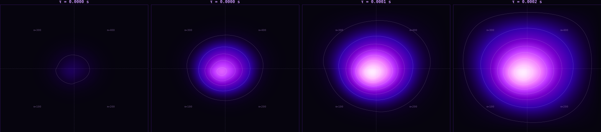

---

```bash
maria@github:~$ ls projects/
```

| Project | Description | Topic(s) | Status | Place/Event |
|---|---|---|---|---|
| `sdc-fault-injection` | Silent data corruption from bit-flips in GPU and hybrid quantum pipelines | HPC · Fault Tolerance ·  Quantum Computing | Prototype. Pending future work | BSC · MNHack26 |
| `seismic-wave-poster` | CUDA wave propagation + PINN for seismic wavefield reconstruction | HPC · SciML · Earth Science · Computational Physics | Presented at PUMPS+AI 26 | BSC, UPC  · PUMPS+AI 26 |
| `nevus-tori` | Computational approach to pathologic anatomy on acral tissue with severe dysplasia | Biomedical Physics · Inverse Problems | Long term ongoing | Personal project |
| `fem-heat-solver` | Assembly-free GPU FEM for heat dissipation in heterogeneous media | HPC· GPU Computing· Numerical Methods (FEM) · Computational Physics | Revisited at MNHack26. Pending follow up work | BSC · MNHack25 |
| `newtonian-limit-study` | Newtonian limit of the Schrödinger equation, different approaches | Theoretical Physics | Completed. Pending to be uploaded. | Research task from a former professor |
| `physics-notebook` | Study notes and derivations | Physics | Ongoing | Personal project |

<sub> Most repos are private while in progress. Request access or check back.</sub>

---

```bash
maria@github:~$ cd background && ls
```
`MNHACK-BSC` `UNED` `CQA-Quantum-Summer-School` `PUMPS+AI-26` `ALBA-Hackathon-2025`  `astrophysics-internship`  `3D-STLPROJECT`  `CCAR` `iCSC26` `geology-olympiads`

<details>
<summary><code>cat MNHACK-BSC/README.md</code></summary>
  
**MNHack8 · BSC, Barcelona · Apr 2026 – Oct 2026 · participant**

Fault-tolerance characterisation of silent data corruption from radiation-induced bit-flips (SEUs) in GPU-accelerated computing, extended to quantum computing as a second context. Built on the MNHack7 solver. Focus: unprotected registers, cache, shared memory and in-transit data (not covered by DRAM ECC), and behaviour at handoff points in hybrid pipelines, using large ensembles for statistically meaningful sensitivity results.

**MNHack7 · BSC, Barcelona · Sep 2025 – Oct 2025 · participant**

Assembly-free FEM solver for heat transfer in heterogeneous materials, accelerated with CUDA and MPI and ported to MareNostrum 5. Runtime went from ~5 h (unoptimised CPU baseline) to 1.8988 s after optimisation, GPU acceleration and porting. Presented to BSC mentors, MN5 staff and peers.
</details>

<details>
<summary><code>cat UNED/README.md</code></summary>

**BSc Physics · UNED · Sep 2021 – present**

Strong computational and experimental leaning. Coursework includes electrodynamics, optics, electromagnetism, nuclear physics, quantum physics and cosmology, with programming and numerical methods alongside.
</details>

<details>
<summary><code>cat ALBA-Hackathon-2025/README.md</code></summary>


<details>
<summary><code>cat CQA-Quantum-Summer-School/README.md</code></summary>

**CQA Undergraduate Quantum Summer School · ICFO, Barcelona · Jul 2026**

Co-hosted by the Catalonia Quantum Academy and ICFO. Foundational and applied quantum computing, with exposure to both academia and industry in the Barcelona ecosystem.
</details>

<details>
<summary><code>cat PUMPS+AI-26/README.md</code></summary>

**PUMPS+AI 2026 Summer School · BSC, Barcelona · Jul 2026**

Co-organised by BSC, UPC and UIUC. Massively parallel systems, GPU acceleration, multi-GPU machine learning, advanced AI optimisation.

**Poster: Seismic Wavefield Reconstruction.** Extends the assembly-free GPU FEM solver to the hyperbolic wave equation in heterogeneous geological media, and asks whether a neural network can reconstruct the wavefield from the mesh.
</details>


**ALBA Synchrotron Hackathon · Oct 2025 · selected participant**

Team entry for Dentaid's challenge: repurpose mouthwash residues as additives for SLA 3D-printing resin.
</details>

<details>
<summary><code>cat astrophysics-internship/README.md</code></summary>

**Intern, Dept. of Astrophysics and Cosmology · University of Murcia · Nov 2022 – May 2023**

Individual and group theoretical research, deriving and analysing results from first principles. Topics: Kerr and Schwarzschild spacetimes, black hole physics, gravitational waves, linearised GR, quantum mechanics (entangled states, measurement problem), and cosmology for non-geodesic observers. Weekly research discussions.
</details>


<details>
<summary><code>cat 3D-STLPROJECT/README.md</code></summary>

**Co-founder · 3D STL Proyect · Ongoing**

3D design and printing brand, e-commerce site under construction. Hands-on work with resin (SLA), filament (FDM) and ceramic (FDM) printers; modelling in Blender and ZBrush.
</details>


<details>
<summary><code>cat CCAR/README.md</code></summary>

**CCAR · UNED high-performance computing centre · member**

Membership of UNED's HPC centre.
</details>

<details>
<summary><code>cat iCSC26/README.md</code></summary>

**Inverted CERN School of Computing 2026 · attended remotely (one week)**

Attended online. No certificate issued, as certification was in-person only.
</details>

<details>
<summary><code>cat geology-olympiads/results.txt</code></summary>

**Geology Olympiads** 

| Competition | Year | Result |
|---|---|---|
| Murcia Regional Geology Olympiad | 2017 | 3rd place. Attended national phase in Salamanca |
| Murcia Regional Geology Olympiad | 2018 | 2nd place. Attended national phase in Segovia |
| Murcia Regional Geology Olympiad | 2019 | 3rd place. |

</details>

---

```bash
maria@github:~$ cd ../reach-out
```
Say hi. Share your pronouns if you'd like. :)

[](https://www.linkedin.com/in/mar%C3%ADa-garc%C3%ADa-penalva-064084281/)
